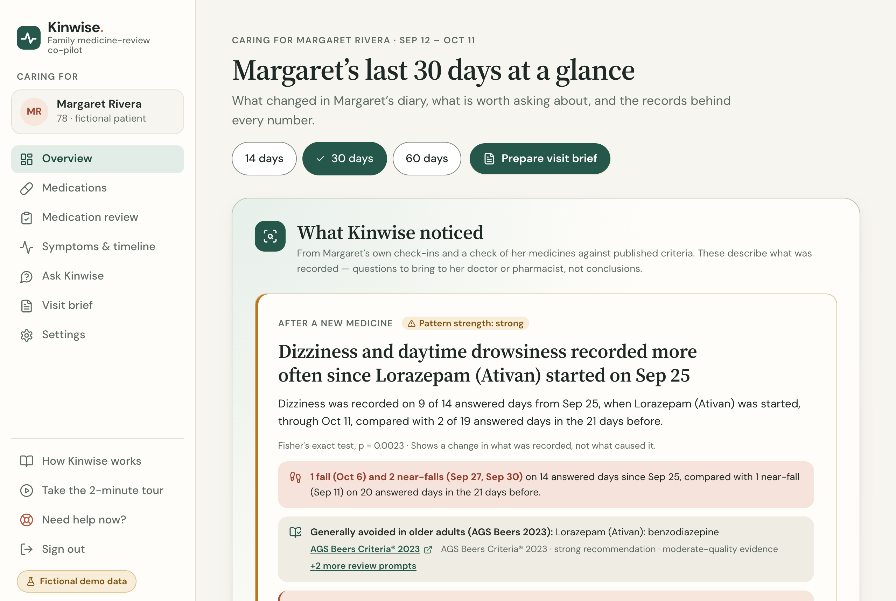
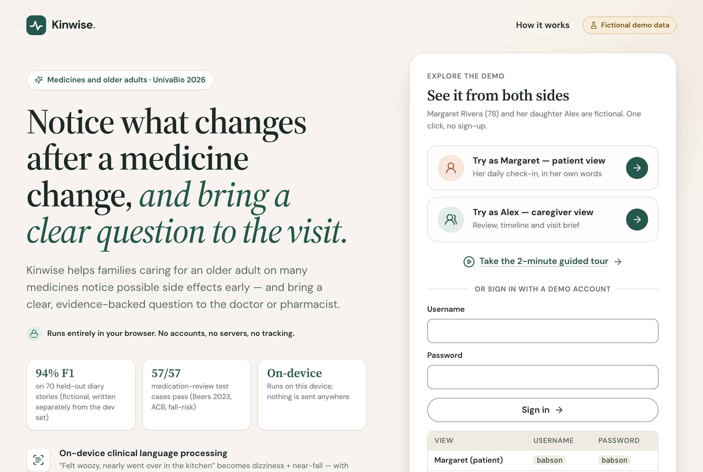
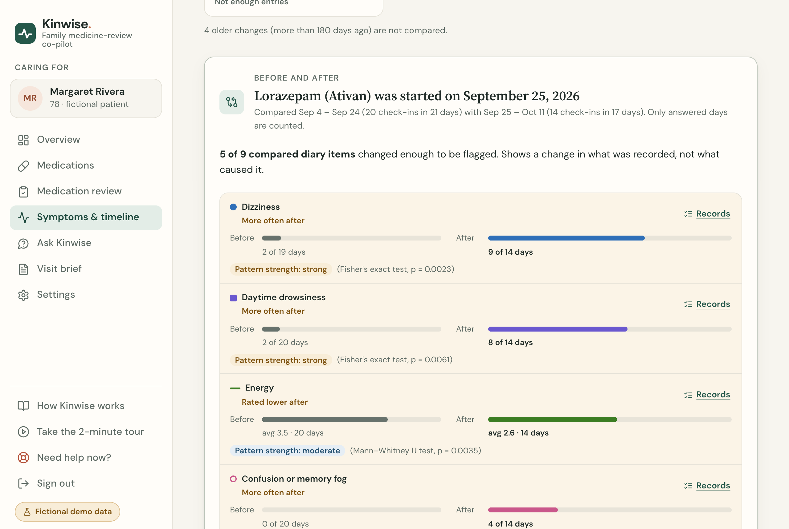
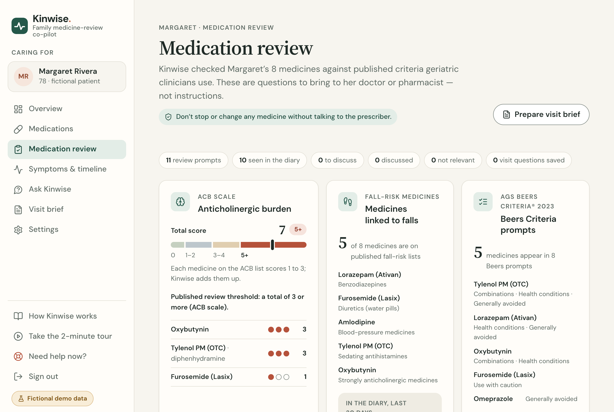
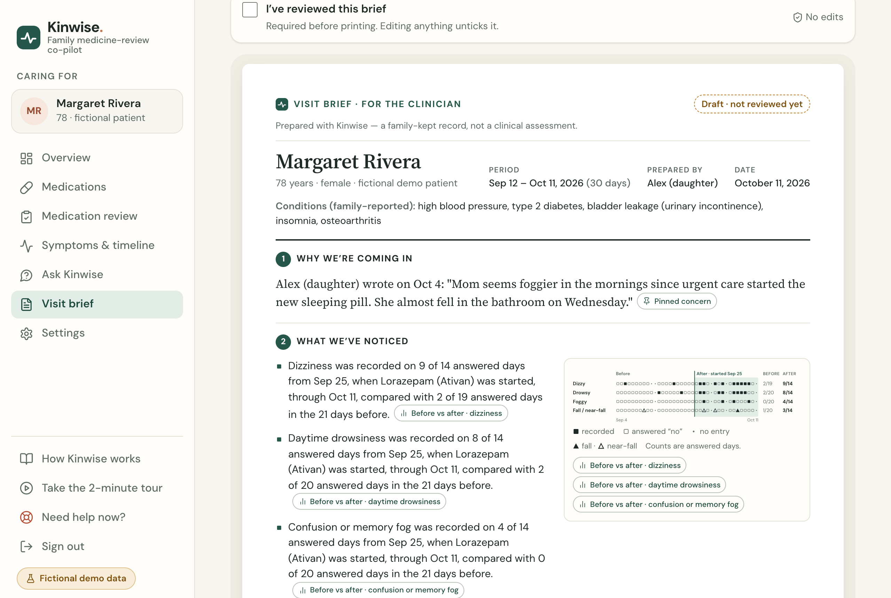
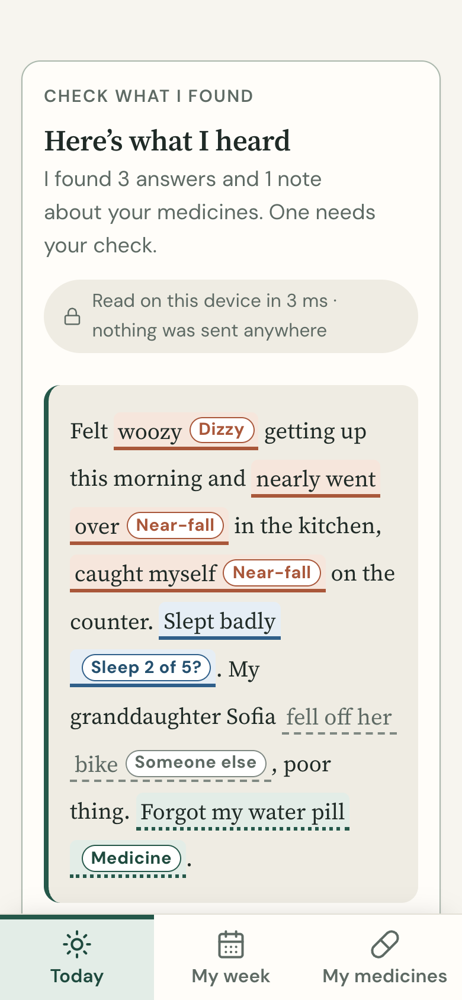
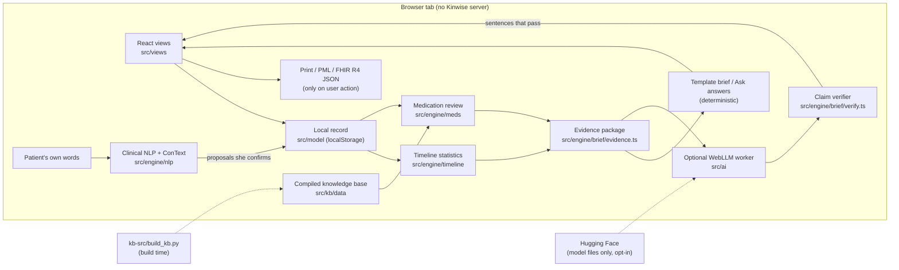

# Kinwise

**Kinwise is a private, in-browser co-pilot that helps families caring for an older adult on many medicines notice
what changes after a medicine change and bring a clear, evidence-backed question to the doctor or pharmacist.**

Submission to the UnivaBio "AI for Human Health" hackathon (2026). All data in the demo is fictional.

> Kinwise is a hackathon prototype. It has not been reviewed or cleared by the FDA and gives no medical advice. Its
> knowledge base has **not** been reviewed by a licensed clinician or pharmacist. Every finding is phrased as a
> question for the clinician. Don't stop or change any medicine without talking to the prescriber. In an emergency,
> call 911.



**Watch:** [demo video, under 3 minutes](submission/kinwise-demo.mp4) (captions: [.srt](submission/kinwise-demo.srt))
· **Read:** [one-page summary](submission/kinwise-one-pager.pdf) · [sample visit brief](submission/kinwise-sample-visit-brief.pdf)
· [code tour PDF](submission/kinwise-code-tour.pdf) · [demo script](docs/DEMO-SCRIPT.md)

**Run it:** `npm ci && npm run dev`, open http://127.0.0.1:5174/ and click **Try as Alex**. More in [Try it](#try-it).
**Code:** https://github.com/albertzorzolan/UnivaBioBabson/tree/medwatch-v2 (branch `medwatch-v2`).

---

## The problem

- **43.0%** of US adults 65+ used five or more prescription drugs in the past 30 days (2017 to March 2020), up from
  33.3% in 2001–2004. *(NCHS, Health, United States)*
- In primary care, **25%** of outpatients had an adverse drug event. Of the ameliorable ones, **63%** persisted because
  medication-related symptoms were not acted on and **37%** because the patient never told the physician.
  *(Gandhi et al., NEJM 2003)*
- **More than 1 in 4** older adults fall each year, and **less than half** tell their doctor. *(CDC, Older Adult Falls)*
- **55%** of America's 63 million family caregivers give medicines, pills or injections, and **22%** received
  training for medical or nursing tasks. *(AARP & National Alliance for Caregiving, Caregiving in the US 2025)*

Clinician tools (Beers Criteria checkers, deprescribing tools) have the criteria but not what the family sees at
home. Diary apps have the home observations but not the criteria. Kinwise puts the two side by side for the visit.
Sources and wording rules: [kb-src/research/market-evidence.md](kb-src/research/market-evidence.md).

## What it does

The demo follows Margaret Rivera (78, fictional) and her daughter Alex.

1. **Margaret checks in in her own words.** "Felt woozy getting up this morning and nearly went over in the kitchen,
   caught myself on the counter." On-device clinical language processing (with ConText negation, time and
   "someone else" handling) proposes diary answers, highlights the exact words behind each one, and she confirms
   them. "My granddaughter fell off her bike" is set aside as being about someone else.
2. **Alex sees the timeline.** For each medicine started or stopped in the last 180 days, Kinwise compares the
   21 days before with up to 21 days after, counting only answered days. In the demo: dizziness was recorded on
   **9 of 14** answered days after lorazepam was started, compared with **2 of 19** in the 21 days before
   (Fisher's exact test, p = 0.0023). Falls are listed rather than tested: 1 fall and 2 near-falls on 14 answered
   days since the start, compared with 1 near-fall on 20 answered days before. The screen states that this shows a
   change in what was recorded, not why.
3. **Medication review.** A deterministic engine checks the list against the AGS Beers Criteria® 2023, the
   Anticholinergic Cognitive Burden (ACB) scale, fall-risk drug lists (CDC STEADI, STOPPFall), prescribing cascades
   (ThinkCascades and primary studies) and "what to watch for" rules for high-risk classes. For Margaret's 8
   medicines it returns 11 review prompts, including an ACB total of 7 and a possible amlodipine → ankle swelling →
   furosemide cascade. Each prompt cites its source and ends in a question for the clinician.
4. **Ask Kinwise.** Questions about the record ("How many near-falls since lorazepam started?") are answered from
   the records with evidence chips. Questions about treatment, doses, diagnosis or cause get a fixed redirect to the
   clinician and an "add to visit questions" button.
5. **Visit brief and export.** A one-page brief for the clinician (reason for the visit, what was noticed, review
   prompts, questions, medication table, limitations) that the caregiver must mark as reviewed before printing; a
   Personal Medication List in the CMS medication-review column layout; and an HL7® FHIR® R4 document Bundle.

An optional on-device language model (Qwen2.5-3B via WebLLM and WebGPU) can draft friendlier wording. It never
decides a flag or a number, and every sentence it writes is checked by code against the evidence before a person
sees it. Without it, everything above works from deterministic templates.

## Screenshots

| | | |
|---|---|---|
|  |  |  |
| Welcome | Caregiver overview | Symptoms & timeline |
|  |  |  |
| Medication review | Visit brief | Patient check-in (390 px wide) |

Screenshots were captured from the local dev server on 2026-10-11 with the seeded demo record. Demo dates are
relative to the day you open the app, so the dates you see will differ; the counts stay the same.

## Try it

**Live demo (planned, not yet deployed):** https://albertzorzolan.github.io/UnivaBioBabson/ — the GitHub Pages
workflow in [.github/workflows/pages.yml](.github/workflows/pages.yml) will publish it from the `medwatch-v2`
branch.

**Run locally** (Node 22):

```bash
npm ci
npm run dev        # http://127.0.0.1:5174/
```

On the Welcome screen use **Try as Margaret** (patient) or **Try as Alex** (caregiver), or sign in:

| View | Username | Password |
|---|---|---|
| Margaret (patient) | `babson` | `babson` |
| Alex (caregiver) | `babson1` | `babson1` |

These demo credentials only pick a role for the fictional record. They are not authentication. "Take the 2-minute
guided tour" walks through the main flow in 8 steps. Settings › Restore demo resets the record.

The optional AI needs a browser with WebGPU (recent desktop Chrome or Edge). Loading the recommended model downloads
about 1.66 GB of model files from Hugging Face; no personal data is sent. We have measured it only on an Apple M1 Pro
(16 GB).

## Working now vs planned

**Working now (in this repository)**

- Patient check-in from free text with on-device NLP, span highlighting and confirmation; My week; My medicines.
- Medication list with brand, generic, combination-product and misspelling matching (427 medicines, 766 brand
  names, 124 combination products in the reference set).
- Deterministic medication review: 89 AGS Beers 2023 rules (Tables 2–6), ACB scale (100 scored medicines), 15
  fall-risk classes, 26 prescribing cascades, 5 "what to watch for" rules, each with citations.
- Before/after timeline statistics (Fisher's exact, Mann–Whitney U) with answered-day denominators, overlapping
  medicine changes listed, falls and near-falls listed by date.
- Ask Kinwise over the person's own records, with scope routing.
- Visit brief (template, always available), print gate on caregiver review, Personal Medication List, FHIR R4
  export. A sample export validated against the public HAPI FHIR R4 server with 0 errors
  ([docs/samples](docs/samples/kinwise-fhir-validation.json)).
- Optional on-device LLM (WebLLM) for brief drafting, record answers, finding explanations and extra check-in
  suggestions, all checked by a claim verifier; deterministic fallback when it is off or fails.
- How it works page that re-runs the NLP benchmark and medication-review suite in the browser.
- Export, import and delete-all of the local record; light and dark themes; three text sizes; guided tour.

**Planned / not done**

- Clinician review of the knowledge base and a validation study with pharmacists and family caregivers.
- Sharing between family members (end-to-end encrypted sync). Today the record lives in one browser, so the patient
  and caregiver views share one device.
- Encryption of the local record at rest (it is stored as plain JSON in `localStorage`).
- Import from pharmacies or patient portals (SMART on FHIR, Medicare Blue Button).
- Voice check-ins and languages other than English (the NLP engine is English-only).
- An FDA MedWatch (Form 3500B) report draft for the family to submit themselves.
- Dose checks, allergy checks and a full drug–drug interaction database (interactions are limited to Beers Table 5).
- A licence for the AGS Beers Criteria® for any non-educational use.
- Public deployment of the demo (workflow written, not yet run).

## Architecture



| Module | What it does | Start reading at |
|---|---|---|
| `src/model` | Domain types, local persistence with role rules, deterministic seed | `types.ts`, `store.ts`, `seed.ts` |
| `src/kb` | Compiled knowledge base and drug-name matching | `index.ts`, `normalize.ts` (`matchDrug`) |
| `src/engine/meds` | Medication review over the KB | `engine.ts` (`reviewWithKb`), `rules/*.ts` |
| `src/engine/timeline` | Before/after windows and statistics | `signals.ts` (`analyzeTimeline`), `stats.ts`, `rules.ts` |
| `src/engine/nlp` | Free text → diary proposals with ConText | `extract.ts` (`extractCheckIn`), `context.ts` |
| `src/engine/brief` | Evidence package, template brief, claim verifier, Q&A, FHIR, medication list | `evidence.ts`, `verify.ts`, `qa.ts`, `fhir.ts`, `cmr.ts` |
| `src/ai` | WebLLM worker, prompts, grammars, AI tasks with verification | `llm.ts`, `tasks.ts`, `models.ts` |
| `src/views`, `src/app`, `src/ui` | Screens, router, shells, tour, design system | `app/App.tsx`, `app/router.ts` |
| `kb-src` | Research inputs and the KB build script | `build_kb.py`, `research/` |
| `eval` | Corpora, case file, eval runners, results | `results/`, `MED-CASES-METHOD.md` |

Full detail: [docs/ARCHITECTURE.md](docs/ARCHITECTURE.md). Product contract: [docs/SPEC.md](docs/SPEC.md) and
[docs/SPEC-UI.md](docs/SPEC-UI.md).

## Evaluation (headline numbers)

| Evaluation | Result | Source |
|---|---|---|
| Symptom extraction, held-out set (70 fictional stories, never used for tuning) | micro-F1 **0.942** (precision 0.972, recall 0.914) over 116 labelled core diary fields | [eval/results/nlp-eval.json](eval/results/nlp-eval.json) |
| Symptom extraction, development set (245 stories, used for tuning) | micro-F1 0.998 | same file |
| Negation on held-out set | 21 of 23 negated mentions correct | same file |
| Medication review, independent case file | **57 of 57** cases, **295 of 295** expectations pass | [eval/results/meds-eval.json](eval/results/meds-eval.json), [notes](eval/results/MED-EVAL-NOTES.md) |
| Timeline false alarms (simulated diaries with no real change) | about 1 in 10 medicine changes show a moderate signal and about 1 in 100 a strong one; nearly 1 in 5 and about 1 in 35 when symptoms are recorded often | `src/engine/timeline/signals.null.test.ts`, `rules.ts` |
| On-device LLM, Qwen2.5-3B on M1 Pro | brief 9 of 9 sentences kept; record answers 4 of 4 cases; ~60 s per brief | [eval/results/llm-smoke.json](eval/results/llm-smoke.json) |
| Live in-app AI run (real WebGPU) | 0 external requests; cached model load 13.7 s; answered Ask questions took 4.1–12.0 s | [eval/results/ai-live.json](eval/results/ai-live.json) |

All cases and stories were written by the team (with AI assistance) and are synthetic. These numbers show the
software does what it was designed to do on test data; they are not clinical validation. Method, caveats and the
errors we found: [docs/EVALUATION.md](docs/EVALUATION.md).

## Privacy and guardrails

- **No Kinwise server, account, analytics or trackers.** The record is stored in this browser's `localStorage`.
  A Content Security Policy in `index.html` limits network access to same-origin files plus the Hugging Face and
  GitHub hosts that serve the optional model files.
- **Sharing only on user action:** print, export FHIR JSON, or export a backup file.
- **Rules decide, the model writes.** Every flag, count and comparison is computed by deterministic code with a
  citation. The language model only rephrases evidence, and a claim verifier is designed to drop sentences with an
  unsupported number, an unknown medicine, causal or advice wording, or missing evidence. In our live WebGPU run it
  still let 3 flawed outputs through (including one "can cause"), which is why the deterministic template stays the
  default and every AI output needs a person's review ([EVALUATION.md §5](docs/EVALUATION.md)).
- **Health-language rules** (SPEC §3) are enforced in the KB build, the engines, the verifier and an end-to-end test:
  counts always come with denominators, findings are questions, nothing tells anyone to start, stop or change a
  medicine, and nothing assigns urgency.
- **Humans confirm:** the patient confirms each extracted answer; the caregiver must mark the brief as reviewed
  before it prints.

Regulatory positioning (designed toward FDA's published examples of record-keeping and communication tools; no
clearance or exemption is claimed): [docs/REGULATORY.md](docs/REGULATORY.md).

## Tech stack

React 19, TypeScript 5.9 (strict), Vite 7, Recharts 3, lucide-react, @mlc-ai/web-llm 0.2.85 (WebGPU, Web Worker),
Qwen2.5-3B-Instruct (q4f16_1, MLC build), Vitest 3, Playwright 1.55 with system Chrome, axe-core, Python 3 (knowledge
base build), HL7 FHIR R4, RxNorm, SNOMED CT and LOINC codes. A GitHub Actions workflow for GitHub Pages is written
but has not run yet.

## Tests and quality gates

| Command | What it checks | Last result we recorded |
|---|---|---|
| `npx vitest run` (or `npm test`) | Unit tests for engines, KB, AI guards and view logic, plus the NLP and medication evals | 1,246 tests in 43 files; on 2026-10-11, 1,245 passed and 1 opt-in test (the FHIR sample writer) was skipped by default |
| `npm run eval:nlp` / `npm run eval:meds` | The two evaluations; update `eval/results/*.json` only when a result changes | see table above |
| `npm run test:e2e` | 20 Playwright checks in system Chrome (logins, check-in, review, timeline, Ask, brief, FHIR, tour, 390 px layout, no foreign network requests, no console errors) | 20 of 20 passed (2026-10-11) |
| `npm run test:a11y` | 46 axe-core scans (WCAG 2.2 A/AA rules), every route in light and dark plus open dialogs and drawers | 46 scans, 0 violations reported (the gate fails on serious or critical) (2026-10-11) |
| `npm run typecheck` | TypeScript strict, no emit | |
| `npm run build` | Type-check and production build | |
| `python3 -I kb-src/build_kb.py --check` | KB integrity, rating cross-checks, banned wording | passes (KB 2026.10.2) |

E2E and accessibility reports are written to `test-results/` (git-ignored).

## Repository layout

```
src/            the app (model, kb, engine/{meds,timeline,nlp,brief}, ai, app, ui, views)
kb-src/         knowledge-base build script, curated sources and research notes
eval/           NLP corpora, medication case file, eval runners, results/
docs/           SPEC, SPEC-UI, ARCHITECTURE, EVALUATION, REGULATORY, CLINICAL-SOURCES, samples/, screenshots/
scripts/        e2e, accessibility, LLM smoke test, model download
submission/     Devpost text, demo video + captions, one-pager, sample visit brief and code-tour PDFs
public/         fonts and favicon (public/models/ is git-ignored)
ai-harness.html developer page used by scripts/llm-smoke.mjs
archive/        earlier team prototypes, not used by this build (see archive/README.md)
```

## Team and credits

- Team: Albert Zorzolan and Neil Shah (Babson).
- Earlier prototypes by team members are kept in [archive/](archive/README.md).
- Clinical criteria: AGS Beers Criteria® 2023 (American Geriatrics Society; Kinwise is not affiliated with or
  endorsed by AGS), ACB scale (Aging Brain Care), CDC STEADI, STOPPFall, ThinkCascades. Full register:
  [docs/CLINICAL-SOURCES.md](docs/CLINICAL-SOURCES.md).
- ConText algorithm: Harkema et al., J Biomed Inform 2009. In-browser inference: WebLLM (MLC). Model: Qwen2.5-3B-Instruct
  (Qwen Research License). Fonts: DM Sans and Source Serif 4 (SIL OFL).
- The name "MedWatch" in older files and branch names is the project's former working name. Kinwise is not
  affiliated with the FDA or its MedWatch program.

## Disclaimer

Kinwise is a hackathon prototype. It has not been reviewed or cleared by the FDA (we claim no exemption; see
[docs/REGULATORY.md](docs/REGULATORY.md)), and it has not been clinically validated. The knowledge base was compiled from published criteria and checked by automated
research, but it has not been reviewed by a licensed clinician or pharmacist. It does not check doses, allergies or
every interaction, and a medicine without a flag has not thereby been shown to be free of risk. All people, records
and dates in the demo are fictional. Nothing here is medical advice; talk to the prescriber before changing any
medicine, and call 911 in an emergency.
