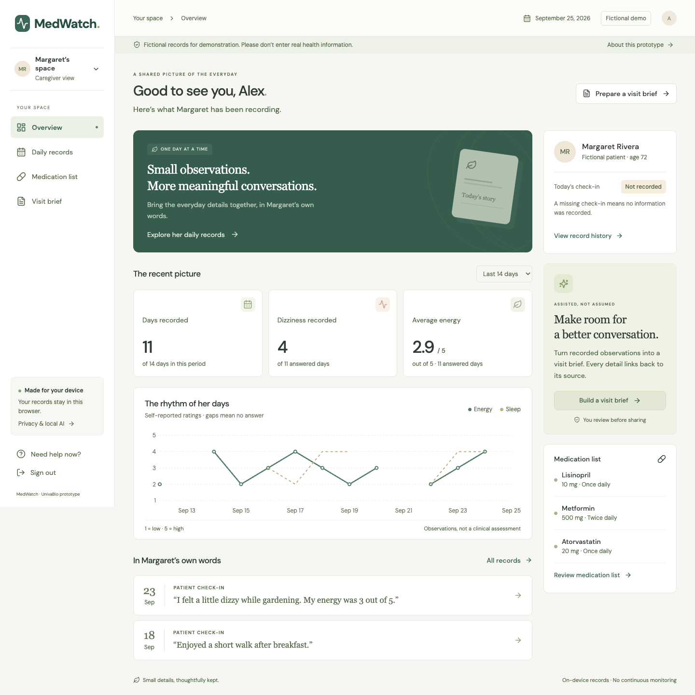

# Prototype #1 - Albert

**MedWatch · UnivaBio: Artificial Intelligence for Human Health**

A working, fictional-data prototype that helps patients record everyday symptoms and caregivers prepare a clear conversation with a clinician. A language model runs locally in the browser to propose structured answers, summarize confirmed records, answer bounded record questions, and draft visit notes. People review AI output before it becomes a record or a shared brief.



## Run the prototype

Use Node.js 22.12 or later and current Chrome with WebGPU support.

```sh
git clone https://github.com/albertzorzolan/UnivaBioBabson.git
cd UnivaBioBabson/prototypes/Prototype-1-Albert/prototype
npm ci
npm run model:download
npm run dev
```

Open **http://127.0.0.1:5173/**. Select **Load local AI** after signing in. The model download is approximately 845 MiB; model files and dependencies are intentionally excluded from Git. Prompts and records are processed locally at runtime. The complete manual form and non-AI report template also work without the model.

| View | Username | Password |
| --- | --- | --- |
| Patient | `babson` | `babson` |
| Caregiver | `babson1` | `babson1` |

These credentials select demo roles; they are not secure authentication. Use fictional information only.

## What is included

- [Runnable app and technical guide](prototype/README.md): patient check-ins, quote-backed AI suggestions, correction history, caregiver dashboards, medication records, source evidence, and reviewed PDF visit briefs.
- [Implementation blueprint](blueprint/README.md): product, architecture, AI contracts, regulatory boundaries, and planned evaluation. Its design-stage status statements are historical; see the implementation guide and actual validation results for the current build.
- [Development validation](prototype/docs/validation.md): 20 unit tests, 16 browser workflow assertions, nine selected real-model scenarios, accessibility scans, printing checks, and cancellation verification, with their limits documented.
- [Captioned demonstration](prototype/output/video/MedWatch-Demo.mp4) and [demo script](prototype/docs/demo-script.md).
- [One-page project description](prototype/output/pdf/MedWatch-Project-Description.pdf), [source-code PDF](prototype/output/pdf/MedWatch-Source-Code.pdf), and [sample visit brief](prototype/output/pdf/MedWatch-Sample-Visit-Brief.pdf).
- [Portable prototype package](prototype/output/MedWatch-Prototype.zip), with setup scripts for dependencies and model assets.

The earlier competition plan and data-flow documents are retained at the repository root for project history. The current blueprint supersedes conflicting earlier plans; the running implementation and its validation record identify what has actually shipped.

## Scope and evidence

This is a student prototype for documentation and visit preparation. It does not diagnose, recommend treatment or medication changes, calculate personalized medication risk, perform clinical triage, or notify clinicians. Clinical benefit, regulatory compliance, and suitability for real-patient use have not been established. Source-explanation AI remains gated pending qualified content review. The nine model scenarios are development checks, not an unseen benchmark or clinical validation.

## Check the code

From `prototype/`:

```sh
npm test
npm run build
```

Additional browser and real-model checks require the local dev server. Commands, hardware details, pinned model artifacts, and known limitations are documented in the [app guide](prototype/README.md) and [validation record](prototype/docs/validation.md).

No application hosting is configured by this repository. Running the prototype serves it on the local computer.
