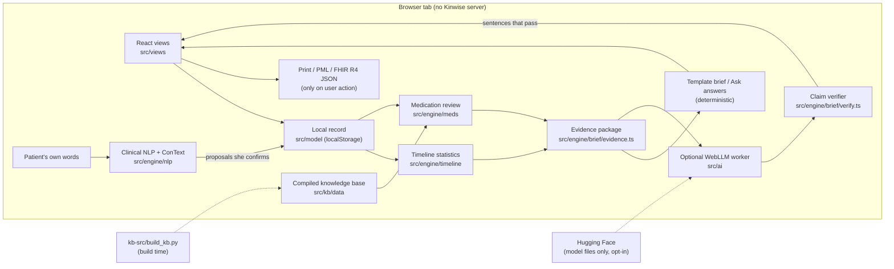

# Kinwise

**Kinwise is a private, in-browser co-pilot that helps families caring for an older adult on many medicines notice
what changes after a medicine change and bring a clear, evidence-backed question to the doctor or pharmacist.**

**Try it live (no install, fictional data):** https://albertzorzolan.github.io/UnivaBioBabson/ → click **Try as Alex**<br>
**Demo video (under 3 minutes, captions):** [submission/kinwise-demo.mp4](submission/kinwise-demo.mp4) ([captions .srt](submission/kinwise-demo.srt)) <!-- TODO(team): replace with YouTube link --><br>
**Code walkthrough:** [5 minutes](#walk-through-the-code-in-5-minutes) · [code tour PDF](submission/kinwise-code-tour.pdf)<br>
**Run locally:** `npm ci && npm run dev`, then open http://127.0.0.1:5174/ ([details](#try-it))

Also: [one-page summary](submission/kinwise-one-pager.pdf) · [sample visit brief](submission/kinwise-sample-visit-brief.pdf)
· [demo script](docs/DEMO-SCRIPT.md). Submission to the UnivaBio "AI for Human Health" hackathon (2026) by Albert
Zorzolan and Neil Shah, Babson College. The code for this build is on the `medwatch-v2` branch:
https://github.com/albertzorzolan/UnivaBioBabson/tree/medwatch-v2 (the repository's `main` branch holds an earlier
prototype).
<!-- TODO(team): this README describes the kinwise-final tree. Commit it together with eval/results/timeline-null.json,
kb-src/README.md, .github/workflows/ci.yml and the timeline null-study changes. If they are not merged into medwatch-v2
(and the demo redeployed), change this branch link and the live-demo-branch wording to match. -->

> Kinwise is a hackathon prototype. It has not been reviewed or cleared by the FDA and gives no medical advice. Its
> knowledge base has **not** been reviewed by a licensed clinician or pharmacist. Every finding is phrased as a
> question for the clinician. Don't stop or change any medicine without talking to the prescriber. In an emergency,
> call 911.


---

## The problem

- **43.0%** of US adults 65+ used five or more prescription drugs in the past 30 days (2017 to March 2020), up from
  33.3% in 2001–2004. *([NCHS, Health, United States](https://www.cdc.gov/nchs/hus/topics/rx-drug-use.htm))*
- In a primary-care study, **19 of 51** (37%) ameliorable adverse drug events (harm that could have been reduced)
  were attributed to the patient not telling the physician about the symptoms. *([Gandhi et al., NEJM 2003](https://pubmed.ncbi.nlm.nih.gov/12700376/))*
- **More than 1 in 4** older adults fall each year, and **less than half** tell their doctor.
  *([CDC, Facts About Older Adult Falls](https://www.cdc.gov/falls/data-research/facts-stats/index.html))*

Clinician tools (Beers Criteria checkers, deprescribing tools) have the criteria but not what the family sees at
home. Diary apps have the home observations but not the criteria. Kinwise puts the two side by side for the visit.
Sources and wording rules: [kb-src/research/market-evidence.md](kb-src/research/market-evidence.md).

## What it does

The demo follows Margaret Rivera (78, fictional) and her daughter Alex.

1. **Margaret checks in in her own words.** "Felt woozy getting up this morning and nearly went over in the kitchen,
   caught myself on the counter." On-device clinical language processing (with ConText negation, time and
   "someone else" handling) proposes diary answers, highlights the exact words behind each one, and she confirms
   them. "My granddaughter fell off her bike" is set aside as being about someone else.
2. **Alex sees the timeline.** For each medicine started or stopped in the last 180 days, Kinwise compares the
   21 days before with up to 21 days after, counting only answered days. In the demo: dizziness was recorded on
   **9 of 14** answered days after lorazepam was started, compared with **2 of 19** in the 21 days before
   (Fisher's exact test, p = 0.0023). Falls are listed rather than tested: 1 fall and 2 near-falls on 14 answered
   days since the start, compared with 1 near-fall on 20 answered days before. The screen states that this shows a
   change in what was recorded, not why.
3. **Medication review.** A deterministic engine checks the list against the AGS Beers Criteria® 2023, the
   Anticholinergic Cognitive Burden (ACB) scale, fall-risk drug lists (CDC STEADI, STOPPFall), prescribing cascades
   (ThinkCascades and primary studies) and "what to watch for" rules for high-risk classes. For Margaret's 8
   medicines it returns 11 review prompts, including an ACB total of 7 and a possible amlodipine → ankle swelling →
   furosemide cascade. Each prompt cites its source and ends in a question for the clinician.
4. **Ask Kinwise.** Questions about the record ("How many near-falls since lorazepam started?") are answered from
   the records with evidence chips. Questions about treatment, doses, diagnosis or cause get a fixed redirect to the
   clinician and an "add to visit questions" button.
5. **Visit brief and export.** A one-page brief for the clinician (reason for the visit, what was noticed, review
   prompts, questions, medication table, limitations) that the caregiver must mark as reviewed before printing; a
   Personal Medication List in the CMS medication-review column layout; and an HL7® FHIR® R4 document Bundle.

An optional on-device language model (Qwen2.5-3B via WebLLM and WebGPU) can draft friendlier wording. It never
decides a flag or a number, and every sentence it writes is checked by code against the evidence before a person
sees it. Without it, everything above works from deterministic templates.

## Who it's for and why it could help

- **Primary user:** an adult child helping a parent on five or more medicines (Alex in the demo); 55% of US family
  caregivers give medicines, pills or injections (AARP & NAC, Caregiving in the US 2025). The parent (Margaret)
  checks in on a large-text screen; the brief is written for her doctor or pharmacist, who decides.
- **When it is used:** before a Medicare Annual Wellness Visit, or a Part D pharmacist's Comprehensive Medication
  Review, which CMS lets the pharmacist do with the caregiver when the beneficiary cannot take part because of
  cognitive impairment ([kb-src/research/regulatory.md](kb-src/research/regulatory.md) §5).
- **Reasons to test it, not proof it works:** in **EMPOWER** (Tannenbaum et al., JAMA Intern Med 2014; cluster RCT,
  n=303), a direct-to-patient educational brochure led to **27% vs 5%** benzodiazepine discontinuation at 6 months
  (the brochure included a taper plan, which Kinwise leaves to the clinician). In **D-PRESCRIBE** (Martin et al.,
  JAMA 2018; cluster RCT, n=489), a consumer-targeted, pharmacist-led educational intervention (education to patients plus a pharmaceutical opinion sent to their physicians) led to **43% vs 12%**
  no longer filling the inappropriate prescription at 6 months. Kinwise is inspired by these trials and has not been
  shown to replicate them.
- **A caution:** in the MedSafer cluster RCT (5,698 patients; McDonald et al., JAMA Intern Med 2022), rule-based
  flags increased deprescribing without reducing 30-day adverse drug events, so we claim better-informed
  conversations, not fewer adverse events. Kinwise has not been tested with real patients, caregivers or clinicians.
- **How the clinician receives it:** the printed brief is what the clinician receives today; FHIR R4 is
  interoperability readiness (SMART on FHIR planned).

## How it differs

From our review of vendor pages on 2026-10-10 ([market-evidence.md §2](kb-src/research/market-evidence.md)).
"Not documented" means we did not find the feature on the vendor's own pages; it does not prove absence.

| Kind of tool | Examples we checked | What we found |
|---|---|---|
| Medication and symptom-diary apps | MyTherapy, CareClinic, Apple Health Medications | Lining symptoms up against medicine start and stop dates with denominators: not documented. Applying Beers, ACB or fall-risk criteria to the person's list: not documented. |
| Clinician deprescribing tools | MedStopper, MedSafer, deprescribing.org | Apply geriatric criteria, but rely on the clinician to supply the list; use of what the family observes at home: not documented. |
| General AI health assistants | ChatGPT Health | Cloud-based and non-deterministic; no deterministic timeline method and no geriatric criteria engine documented. |

## Status: working, partial, planned

| | |
|---|---|
| **Working** | Public live demo; check-in with on-device language processing; medicine matching (brands, misspellings); cited review; before/after timeline; Ask Kinwise; visit brief with review gate; medication list; FHIR export; backup and delete-all |
| **Partial** | On-device AI: desktop Chrome or Edge with WebGPU, tested on one Apple M1 Pro, checker not airtight; the default Qwen2.5-3B has a research-only (non-commercial) licence, and Apache-2.0 models are selectable in Settings. Patient-to-caregiver hand-off: one shared device today, or a backup file. FHIR: no receiving system yet. Knowledge base: not clinician-reviewed, no dose or allergy checks. English only |
| **Planned** | Encrypted family sharing; encryption of the local record; pharmacist review of the knowledge base; a validation pilot; pharmacy and portal import; voice and Spanish |

What each item means in this repository:

- **Public live demo:** https://albertzorzolan.github.io/UnivaBioBabson/, built from the `medwatch-v2` branch by
  [.github/workflows/pages.yml](.github/workflows/pages.yml) and live since 2026-10-11.
- **Medicine matching and cited review:** 427 medicines, 766 brand names and 124 combination products in the
  reference set; 89 AGS Beers 2023 rules (Tables 2–6), the ACB scale (100 scored medicines), 15 fall-risk classes,
  26 prescribing cascades and 5 "what to watch for" rules, each with citations
  ([src/kb/data/meta.json](src/kb/data/meta.json)).
- **Visit brief, medication list and FHIR:** the template brief is always available and prints only after the
  caregiver marks it as reviewed; a sample FHIR R4 export returned 0 errors from the public HAPI FHIR R4 validator
  ([docs/samples](docs/samples/kinwise-fhir-validation.json)).
- **Backup, delete-all and the patient-to-caregiver hand-off:** the patient and caregiver views share one browser.
  Caregiver Settings can export the whole record as one JSON file and import such a file; an imported file is
  validated and shown for confirmation, and then **replaces** the record on that device (no merge, no sync). The
  file is not encrypted. Delete-all leaves an empty record.
- **On-device AI:** brief drafting, record answers, finding explanations and extra check-in suggestions, each
  checked by the claim verifier, with a deterministic fallback. In the live run the verifier let at least 3 flawed
  AI outputs through, and cancelling a draft mid-way was fragile ([EVALUATION.md §5](docs/EVALUATION.md)). The
  default model, Qwen2.5-3B-Instruct, is under the Qwen Research License; the Apache-2.0 options in Settings are
  Qwen2.5-1.5B, Qwen3-4B, Qwen3.5-2B and Qwen3.5-4B, and the two we smoke-tested (Qwen2.5-1.5B, Qwen3.5-2B) were less
  reliable ([eval/results/llm-smoke.json](eval/results/llm-smoke.json)).
- **Knowledge base:** dose-, formulation- and indication-dependent criteria are not encoded, and drug–drug
  interactions are limited to Beers Table 5. A medicine without a flag has not been shown to be free of risk. Any
  non-educational use would need a licence for the AGS Beers Criteria®.
- **Also planned:** a Form FDA 3500B (MedWatch) draft that the family submits themselves, never automatically.

## Screenshots

| | | |
|---|---|---|
|  |  |  |
| Welcome | Caregiver overview | Symptoms & timeline |
|  |  |  |
| Medication review | Visit brief | Patient check-in (390 px wide) |

Screenshots were captured from the local dev server on 2026-10-11 with the seeded demo record. Demo dates are
relative to the day you open the app, so the dates you see will differ; the counts stay the same.

## Try it

**Live demo:** https://albertzorzolan.github.io/UnivaBioBabson/ (no install). The GitHub Pages workflow in
[.github/workflows/pages.yml](.github/workflows/pages.yml) runs the tests, builds the app from the `medwatch-v2`
branch and publishes it; it has served the demo since 2026-10-11.

**Run locally** (Node 22):

```bash
npm ci
npm run dev        # http://127.0.0.1:5174/
```

On the Welcome screen use **Try as Margaret** (patient) or **Try as Alex** (caregiver), or sign in:

| View | Username | Password |
|---|---|---|
| Margaret (patient) | `babson` | `babson` |
| Alex (caregiver) | `babson1` | `babson1` |

These demo credentials only pick a role for the fictional record. They are not authentication. "Take the 2-minute
guided tour" walks through the main flow in 8 steps. Settings › Restore demo resets the record.

The optional AI needs a browser with WebGPU (recent desktop Chrome or Edge). Loading the recommended model downloads
about 1.66 GB of model files from Hugging Face; no personal data is sent. We have measured it only on an Apple M1 Pro
(16 GB).

## Walk through the code in 5 minutes

Five stops, about a minute each, in the same order as the [code tour PDF](submission/kinwise-code-tour.pdf).

1. **Before/after statistics:** [`compareMetric`](src/engine/timeline/signals.ts) in `src/engine/timeline/signals.ts`
   and [`fisherExact`](src/engine/timeline/stats.ts) in `src/engine/timeline/stats.ts`. For one diary item it counts
   answered days in the window before and after a medicine change, compares only when both windows have enough
   answered days, and runs a two-sided Fisher's exact test (yes/no items, checked against R's `fisher.test` values)
   or a Mann–Whitney U test (1–5 ratings).
2. **Medication review:** [`reviewWithKb`](src/engine/meds/engine.ts) in `src/engine/meds/engine.ts` and
   [`cascadeFindings`](src/engine/meds/rules/cascades.ts) in `src/engine/meds/rules/cascades.ts`. The whole review
   pipeline (Beers, cascades, duplicates, watch-for rules, ACB, fall risk → dedupe → language guard → stable sort)
   is one short function; the cascade rule reports a "marker" medicine started after an "index" medicine whose
   known effect it may be treating, such as amlodipine → ankle swelling → furosemide.
3. **Clinical NLP:** [`analyzeInSentence`](src/engine/nlp/context.ts) in `src/engine/nlp/context.ts`. Our ConText
   implementation decides for one symptom mention whether it is negated ("didn't fall"), historical or
   hypothetical ("last week", "if"), or about someone else ("my granddaughter fell").
4. **Checking the AI:** [`verifySection`](src/ai/tasks.ts) in `src/ai/tasks.ts` →
   [`verifyClaims`](src/engine/brief/verify.ts) in `src/engine/brief/verify.ts`. Every sentence the model writes is
   split, matched to its cited evidence, and is designed to drop any sentence with an unsupported number or
   medicine, missing evidence, or causal, advice or urgency wording. The patterns are not exhaustive: in the live run
   at least 3 flawed outputs got through ([EVALUATION.md §5](docs/EVALUATION.md)), so the template stays the default
   and a person reviews every AI draft.
5. **Ask Kinwise scope:** [`routeQuestion`](src/engine/brief/qa.ts) in `src/engine/brief/qa.ts`. Before any model
   call, ordered keyword rules route questions about treatment, changing a dose, diagnosis, cause, prediction or
   emergencies to a fixed redirect to the clinician (or 911); looking up the recorded dose is answered from the list.

**Proof:** `npm ci && npm test` runs the unit tests and both evaluations.

## Architecture



| Module | What it does | Start reading at |
|---|---|---|
| `src/model` | Domain types, local persistence with role rules, deterministic seed | `types.ts`, `store.ts`, `seed.ts` |
| `src/kb` | Compiled knowledge base and drug-name matching | `index.ts`, `normalize.ts` (`matchDrug`) |
| `src/engine/meds` | Medication review over the KB | `engine.ts` (`reviewWithKb`), `rules/*.ts` |
| `src/engine/timeline` | Before/after windows and statistics | `signals.ts` (`analyzeTimeline`), `stats.ts`, `rules.ts` |
| `src/engine/nlp` | Free text → diary proposals with ConText | `extract.ts` (`extractCheckIn`), `context.ts` |
| `src/engine/brief` | Evidence package, template brief, claim verifier, Q&A, FHIR, medication list | `evidence.ts`, `verify.ts`, `qa.ts`, `fhir.ts`, `cmr.ts` |
| `src/ai` | WebLLM worker, prompts, grammars, AI tasks with verification | `llm.ts`, `tasks.ts`, `models.ts` |
| `src/views`, `src/app`, `src/ui` | Screens, router, shells, tour, design system | `app/App.tsx`, `app/router.ts` |
| `kb-src` | Research inputs and the KB build script | `build_kb.py`, `research/` |
| `eval` | Corpora, case file, eval runners, results | `results/`, `MED-CASES-METHOD.md` |

Full detail: [docs/ARCHITECTURE.md](docs/ARCHITECTURE.md). Product contract: [docs/SPEC.md](docs/SPEC.md) and
[docs/SPEC-UI.md](docs/SPEC-UI.md).

## Evaluation (headline numbers)

| Evaluation | Result | Source |
|---|---|---|
| Symptom extraction, held-out set (70 fictional stories, never used for tuning) | micro-F1 **0.942** (precision 0.972, recall 0.914) over 116 labelled core diary fields | [eval/results/nlp-eval.json](eval/results/nlp-eval.json) |
| Symptom extraction, development set (245 stories, used for tuning) | micro-F1 0.998 | same file |
| Negation on held-out set | 21 of 23 negated mentions correct | same file |
| Medication review, separately written case file (not blind; same team directed both agents, see [method](eval/MED-CASES-METHOD.md)) | **57 of 57** cases, **295 of 295** expectations pass | [eval/results/meds-eval.json](eval/results/meds-eval.json), [notes](eval/results/MED-EVAL-NOTES.md) |
| Timeline false alarms (simulated diaries with no real change) | At least one moderate-or-strong signal on about 11% of changes with independent days (about 18–19% with frequent symptoms) and at least one strong signal on about 0.8% (about 2.7%) in the 8,000-change run ([rules.ts](src/engine/timeline/rules.ts), [EVALUATION.md §3](docs/EVALUATION.md); the 1,000-change re-check in timeline-null.json gives 11.2% / 0.3%). If each answer copies the previous day's with probability 0.8: 85.8% and 61.0% (timeline-null.json; an assumed level of clustering). How clustered real diaries are has not been measured. | [eval/results/timeline-null.json](eval/results/timeline-null.json), [signals.null.test.ts](src/engine/timeline/signals.null.test.ts) (fails if the rates drift), [rules.ts](src/engine/timeline/rules.ts) |
| On-device LLM smoke test, Qwen2.5-3B on M1 Pro | brief 9 of 9 sentences kept; record answers 4 of 4 cases; ~60 s per brief | [eval/results/llm-smoke.json](eval/results/llm-smoke.json) |
| Live in-app AI run (real WebGPU) | 0 external requests; cached model load 13.7 s; answered Ask questions took 4.1–12.0 s; at least 3 flawed AI outputs got past the verifier | [eval/results/ai-live.json](eval/results/ai-live.json), [EVALUATION.md §5](docs/EVALUATION.md) |

All cases and stories are synthetic (see [How we built it](#how-we-built-it-and-how-we-used-ai)). These numbers show
the software does what it was designed to do on test data; they are not clinical validation. Method, caveats, the
errors we found and any later baseline, CI and red-team results: [docs/EVALUATION.md](docs/EVALUATION.md).

## Privacy and guardrails

- **No Kinwise server, account, analytics or trackers.** The record is stored in this browser's `localStorage`.
  A Content Security Policy in `index.html` limits network access to same-origin files plus the Hugging Face and
  GitHub hosts that serve the optional model files.
- **Sharing only on user action:** print, export FHIR JSON, or export a backup file.
- **Rules decide, the model writes.** Every flag, count and comparison is computed by deterministic code with a
  citation. The language model only rephrases evidence, and a claim verifier is designed to drop sentences with an
  unsupported number, an unknown medicine, causal or advice wording, or missing evidence. In our live WebGPU run it
  still let at least 3 flawed outputs through (including one "can cause"), which is why the deterministic template
  stays the default and every AI output needs a person's review ([EVALUATION.md §5](docs/EVALUATION.md)).
- **Health-language rules** (SPEC §3) are enforced in the KB build, the engines, the verifier and an end-to-end test:
  counts always come with denominators, findings are questions, nothing tells anyone to start, stop or change a
  medicine, and nothing assigns urgency.
- **Humans confirm:** the patient confirms each extracted answer; the caregiver must mark the brief as reviewed
  before it prints.

Regulatory positioning (designed toward FDA's published examples of record-keeping and communication tools; no
clearance or exemption is claimed): [docs/REGULATORY.md](docs/REGULATORY.md).

## How we built it (and how we used AI)

- **AI coding assistants.** We used AI coding assistants (Claude Code) extensively, under our direction, to write
  code, tests and synthetic evaluation data, as the organizers encourage. We can walk through every module; start
  with the [5-minute walkthrough](#walk-through-the-code-in-5-minutes).
- **Our design decisions.** Rules decide and the model only writes; counts use answered-day denominators (an
  unanswered day is never counted as a "no"); the false-alarm rate of the before/after comparison is measured by
  simulation and shown on screen; the caregiver must review the brief before it prints; causal and advice wording
  is banned and checked by code.
- **Evaluation data.** The evaluation sets were written by separate AI agents directed by the team and are not
  clinician-reviewed. The medication case file's author did not read the engine, but the case file was available
  while the engine was developed, so 57 of 57 is a consistency check, not a blind test
  ([eval/MED-CASES-METHOD.md](eval/MED-CASES-METHOD.md)).
- **Development history.** Each of us first built a prototype (Neil's `prototype-v1-neil`, commit `fc2c5d5`, and
  Albert's Prototype 1); both are kept unchanged in [archive/](archive/README.md). Their ideas were merged into the
  v2 rebuild (the archived code does not run in this build), which was committed in one commit (`375e1e0`) from Albert's `Mendrapp`
  git identity. The git history therefore does not show the step-by-step work.
- **Team:** Albert Zorzolan and Neil Shah, Babson College.

## Tech stack

React 19, TypeScript 5.9 (strict), Vite 7, Recharts 3, lucide-react, @mlc-ai/web-llm 0.2.85 (WebGPU, Web Worker),
Qwen2.5-3B-Instruct (q4f16_1, MLC build), Vitest 3, Playwright 1.55 with system Chrome, axe-core, Python 3 (knowledge
base build), HL7 FHIR R4, RxNorm, SNOMED CT and LOINC codes. GitHub Actions:
[pages.yml](.github/workflows/pages.yml) tests, builds and publishes the live demo; [ci.yml](.github/workflows/ci.yml)
runs the type check, the test suite and the knowledge-base check on pushes to `medwatch-v2` and `kinwise-final` and on
pull requests.

## Tests and quality gates

| Command | What it checks | In CI |
|---|---|---|
| `npm test` (or `npx vitest run`) | The full Vitest suite (more than 1,200 tests): engines, KB, AI guards and view logic, plus the NLP and medication evals | yes |
| `npm run eval:nlp` / `npm run eval:meds` | The two evaluations; update `eval/results/*.json` only when a result changes | yes, as part of `npm test` |
| `npm run typecheck` | TypeScript strict, no emit | yes |
| `python3 -I kb-src/build_kb.py --check` | Builds the KB in memory and validates it: integrity, rating cross-checks, banned wording (exit 1 on any problem) | yes |
| `npm run build` | Type-check and production build | pages.yml runs `npm run build:pages` |
| `npm run test:e2e` | Playwright checks in system Chrome: logins, check-in, review, timeline, Ask, brief, FHIR, tour, 390 px layout, no foreign network requests, no console errors | no (needs system Chrome) |
| `npm run test:a11y` | axe-core scans (WCAG 2.2 A/AA rules) of every route in light and dark, plus open dialogs and drawers; the gate fails on serious or critical violations | no (needs system Chrome) |

E2E and accessibility results are written to `test-results/` (git-ignored); see that folder after a run.

## Repository layout

```
src/                the app (model, kb, engine/{meds,timeline,nlp,brief}, ai, app, ui, views)
kb-src/             knowledge-base build script, curated sources and research notes (kb-src/README.md explains the build)
eval/               NLP corpora, medication case file, eval runners, results/
docs/               SPEC, SPEC-UI, ARCHITECTURE, EVALUATION, REGULATORY, CLINICAL-SOURCES, DEMO-SCRIPT, samples/, screenshots/
scripts/            e2e (browser-test.mjs), accessibility (a11y.mjs), LLM smoke test (llm-smoke.mjs), model download
scripts/submission/ builds the submission files: make-pdfs.mjs (one-pager, sample brief, code tour), record-demo.mjs
                    (demo video and captions), facts.mjs (every number the PDFs print, read from repo files),
                    check-facts.mjs (checks the numbers in the submission text)
submission/         Devpost text, demo video + captions, one-pager, sample visit brief and code-tour PDFs
public/             fonts and favicon (public/models/ is git-ignored)
ai-harness.html     developer-only page for the on-device LLM smoke test (driven by scripts/llm-smoke.mjs); not part of the app
archive/            earlier team prototypes, not used by this build (see archive/README.md)
.github/workflows/  pages.yml (live demo) and ci.yml (type check, tests, KB check)
```

How the knowledge base is built: [kb-src/README.md](kb-src/README.md).

## Team and credits

- Team: Albert Zorzolan and Neil Shah, Babson College.
- Earlier prototypes by team members are kept in [archive/](archive/README.md).
- Clinical criteria: AGS Beers Criteria® 2023 (American Geriatrics Society; Kinwise is not affiliated with or
  endorsed by AGS), ACB scale (Aging Brain Care), CDC STEADI, STOPPFall, ThinkCascades. Full register:
  [docs/CLINICAL-SOURCES.md](docs/CLINICAL-SOURCES.md).
- ConText algorithm: Harkema et al., J Biomed Inform 2009. In-browser inference: WebLLM (MLC). Model: Qwen2.5-3B-Instruct
  (Qwen Research License). Fonts: DM Sans and Source Serif 4 (SIL OFL).
- The name "MedWatch" in older files and branch names is the project's former working name. Kinwise is not
  affiliated with the FDA or its MedWatch program.

## Disclaimer

Kinwise is a hackathon prototype. It has not been reviewed or cleared by the FDA (we claim no exemption; see
[docs/REGULATORY.md](docs/REGULATORY.md)), and it has not been clinically validated. The knowledge base was compiled
from published criteria and checked by automated research, but it has not been reviewed by a licensed clinician or
pharmacist. It does not check doses, allergies or every interaction, and a medicine without a flag has not thereby
been shown to be free of risk. All people, records and dates in the demo are fictional. Nothing here is medical
advice; talk to the prescriber before changing any medicine, and call 911 in an emergency.
