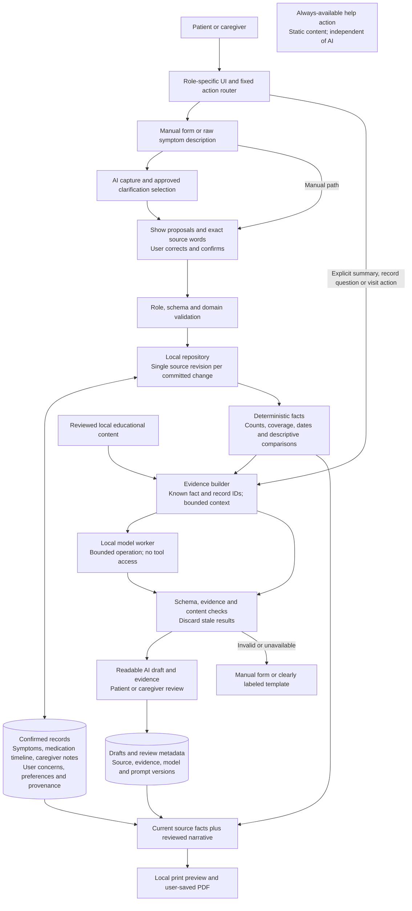
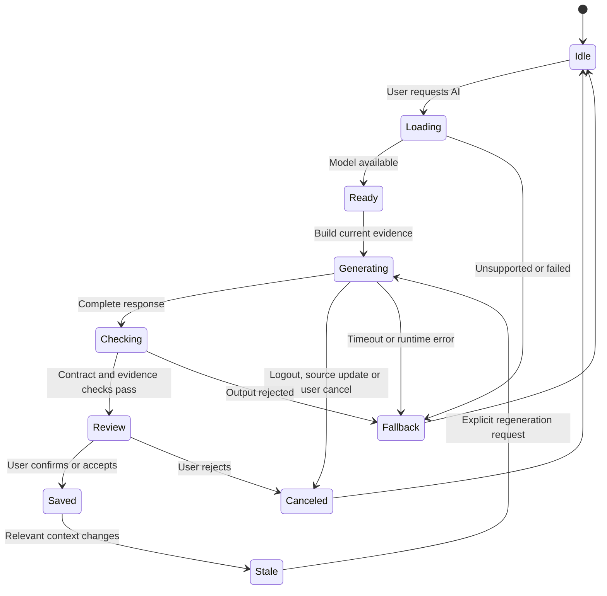
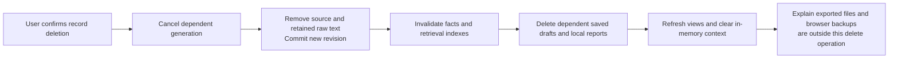

# Architecture and data specification

## 1. Runtime and module boundaries

Use React, TypeScript, Vite, plain CSS or configured Tailwind, and Recharts. Use one local repository abstraction for the small prototype dataset. Use a pinned local inference runtime and model assets. There is no patient-data server, remote inference endpoint, vector database or remote authentication service.

WebLLM is the first runtime candidate, not a selected and verified model. Its documentation supports browser-local inference and workers; actual compatibility, model quality, load size and latency must be established on the demo machine. [WebLLM](https://webllm.mlc.ai/docs/), [worker support](https://webllm.mlc.ai/docs/user/advanced_usage.html)

The architecture deliberately separates a model's proposed text/fields from confirmed source records and calculated facts. A model cannot write records or choose tool calls.



## 2. Proposed application directory

```text
src/
  app/                 routes, session, role guards, demo notice
  features/
    check-in/          manual form, narrative input, confirmation and corrections
    history/           record summaries, timeline, coverage and evidence drawer
    medications/       caregiver CRUD, patient list, change-event editor
    caregiver/         observation notes, user-pinned concerns, overview
    record-questions/  bounded record retrieval and grounded answer view
    education/         reviewed source browsing and simplified explanation
    visit/             draft review, source bundle and print layout
    settings/          display preferences, local data deletion, model cache
    help/              static help and contact information; no triage engine
  domain/              types, schemas, invariants, permissions and release policy
  data/                repository, serialization, migrations, revisions and seed
  analysis/            calendar windows, counts, coverage, descriptive comparisons
  ai/                  request coordinator, worker, adapter, cancellation
    prompts/           six versioned operation templates
    evidence/          source selection, fact IDs, hashing and bounded retrieval
    validation/        schema, semantic checks, evidence and content checks
  content/             approved question bank, source manifest, static help
  components/          accessible fields, buttons, status and evidence components
  styles/              tokens, responsive layout and print stylesheet
tests/
  domain/              persistence, roles, dates, revisions and data deletion
  ai-contracts/        parsers, source spans, evidence resolution and stale results
  fixtures/           synthetic records and expected calculations
  browser/            critical end-to-end workflows and network observations
  evaluations/        raw model outputs, ratings and reproducible reports
public/
  model/               locally served artifacts or setup-managed placement
docs/                  intended use, source register, model card and results
submission/            video, project-description PDF, code PDF and manifest
```

These are proposed paths in a future app; the current workspace contains only blueprint artifacts. Pin dependency versions during the feasibility milestone and keep a lockfile. Keep third-party model weights out of source control unless their size and license justify another documented arrangement.

## 3. Service contracts

| Service | Inputs | Outputs and invariants |
|---|---|---|
| `SessionService` | Demo credentials or logout | Known role and a session-generation counter. Logout invalidates pending work. Passwords are not persisted. |
| `SymptomService` | Role, target local date, confirmed answers and provenance | Upsert current daily record; append correction event; save once. AI suggestions alone are never accepted as confirmation. |
| `MedicationService` | Caregiver command and expected source revision | Medication record/change event. Separate editing a mistaken entry from a reported start/stop/change in actual usage. |
| `CaregiverNoteService` | Caregiver note and date | Attributed observer note; not a patient self-report or a diagnosis. |
| `Repository` | Expected revision and validated candidate document | Persisted new document/revision or an explicit error. No success event before storage succeeds. |
| `FactService` | Immutable source snapshot and selected windows | Rebuildable facts, denominators and limitations. No medical risk score or causal finding. |
| `EvidenceService` | Operation, source snapshot, concern/question and reviewed source selection | Bounded package and hash, with an exact ID-to-fact/record/source map. |
| `AiCoordinator` | Fixed allowed operation and evidence package | Request lifecycle, local-model response, validated draft or typed fallback. No arbitrary tools, URLs or storage writes. |
| `DraftService` | Validated output and review action | Draft plus provenance and review state; no source revision change solely for review. |
| `ReportService` | Current records, facts and eligible reviewed draft | Immutable print snapshot and generation metadata; rejects stale draft. |
| `DataLifecycleService` | Explicit delete/reset command | Delete scoped source records, dependent drafts and indexes; cancel pending work; keep model cache separate. |

## 4. Source and derived data

| Record | Required information | Writer |
|---|---|---|
| Source document | `schemaVersion`, `datasetId`, `sourceRevision`, `isDemoData`, timestamps, collections | Repository only |
| Medication | Stable ID, entered name, dose/frequency text, reason, start date, optional prescriber/end date, removal metadata | Caregiver after validation |
| Medication event | Record ID, event type, recorded/effective dates, before/after values, correction-versus-regimen-change distinction | Medication service |
| Confirmed symptom day | See JSON Schema: local date/timezone, seven answers, raw story, per-answer provenance, confirmation and record revision | Patient confirmation through symptom service |
| Caregiver observation | Note ID, text, date, actor role and attribution; optionally linked source IDs | Caregiver; separate from the daily answers |
| User concern | Concern ID, text, owner role, optional record IDs, pinned state and timestamps | User action; no inferred clinical priority |
| Source reference | ID, title, publisher, URL, content version/hash, reviewed excerpt, review status and review date | Bundled content release, never model output |
| Fact | Stable fact ID, metric, numerator/denominator or scale summary, period, source record IDs and coverage state | Deterministic calculation |
| AI draft | Operation, request ID, source/evidence versions, model/runtime/prompt versions, generated text, review/edits, mode and timestamps | Validated model response; subsequent explicit user review |
| Report | Immutable content, source revision, evidence/model/prompt provenance, AI/template mode and generation timestamp | Report service |

One patient/date has one current confirmed daily answer set. Historical corrections are separate events, not additional days. `null` means unanswered/unknown and must never coerce to `false` or `0`. Keep source-span evidence on accepted AI proposals. Manual edits change their provenance to a user-entered answer while preserving the earlier draft separately only if retained by policy.

Use UTC timestamps for events and a separately stored `YYYY-MM-DD` local date plus timezone for daily identity. Date assignment is selected/confirmed by the user; model text such as “yesterday” is not silently converted using UTC. Prevent future-dated check-ins in the ordinary daily flow; medication plans may have future dates but must not contribute post-start observations before those dates occur.

## 5. Storage design

Suggested keys:

- `medwatch.demo.session`: known role and sign-in metadata.
- `medwatch.demo.source`: one versioned JSON source document, including the dataset epoch/ID.
- `medwatch.demo.derived`: calculated facts and chart series, keyed to source and algorithm versions.
- `medwatch.demo.drafts`: bounded saved AI/template drafts and review metadata.
- `medwatch.demo.reports`: user-generated report snapshots.

Model files use the runtime's browser cache. Large binary assets must not be stored in localStorage. Browser-local storage is not application-level encryption and does not protect against same-origin malicious scripts or another person using the profile. It is acceptable here only as the stated fictional-data prototype design; real-data deployment needs a new security assessment.

Read → parse → schema validation → supported migration → hydrate. Seed only when the source key is absent. Empty arrays are legitimate saved data. Corrupt or unsupported records produce an error and recovery choice, not silent reseeding. A model-load failure cannot block opening the manual form.

The source write is one storage operation. On quota or storage failure, retain the previous committed document and unsaved form input; show an unsaved state. Derived results can be recomputed. Do not simulate multi-key transactions for medication and symptom source changes.

The prototype supports one active editing tab. Secondary tabs must be read-only under a tested single-writer mechanism; detect storage changes, invalidate drafts and refresh. A last-read revision comparison alone is not an atomic cross-tab lock. Do not claim general multi-device or concurrent collaboration support.

## 6. Record calculations

1. Count only confirmed patient-origin answers for the metric. Observer notes are labeled narrative context.
2. For yes/no measures, use positive days divided by days with a valid answer. Show both counts.
3. Keep dizziness presence separate from self-selected severity on days where dizziness is present. Unknown severity does not become zero.
4. For energy and sleep, show score distributions or a clearly labeled descriptive scale summary. Preserve the direction and original scale; do not present ordinal-score changes as clinical effect sizes.
5. Default history uses recent 7 versus preceding 7 calendar days, with actual answered-day counts. Selected event comparisons use up to 14 days before and 14 after; exclude the start day if temporal ordering is unknown.
6. The event comparison needs at least 7 answered days in each window as a prototype display rule. It is not a validated clinical threshold. Other views may show raw entries even when comparison is unavailable.
7. Never fill missing dates with healthy values. Avoid relative percentage increases from a zero baseline; show raw counts and an absolute percentage-point difference if appropriate.
8. Show overlapping medication events and corrections as context. Do not calculate a “culprit medication,” likelihood of side effect, fall risk or urgency category.

## 7. AI lifecycle and freshness



The request fingerprint includes dataset ID, source revision, selected date windows, operation, concern/question, actor/view permission, evidence hash, source-content version, analysis version, model ID/version, prompt version and policy version. The host owns these values. Verify matching request ID/revision/hash in the response, then check the full host fingerprint before displaying or committing the result.

Changing source data, switching role, resetting the dataset or logging out cancels/discards the old request. Reset creates a new dataset ID so an old revision 1 result cannot match a new revision 1 dataset. Model/prompt/content-policy changes invalidate eligible cached drafts. Accepting a draft changes draft metadata only; it must not invalidate itself.

Process one generation at a time, with explicit queue/cancel behavior and maximum input/output lengths. Record raw latency for evaluation. Set a bounded timeout; do not retry indefinitely. One controlled retry may be allowed for a formatting error, but repeated failure returns the manual/template path. Label cached output as previously generated.

## 8. Evidence retrieval and external boundaries

Record queries filter a bounded local date range and confirmed records before passing context to the model. Use typed fact IDs and source IDs, not text-derived URLs. Source explanations receive only the chosen general excerpt, not the patient profile. The model cannot browse, send messages, access storage, call a function tool or modify the reference library.

Serve all app/runtime/model assets from the configured local origin for the demo. Audit the network waterfall and dependency settings; block background third-party requests. Use a tested content security policy, escape text, do not render raw model HTML, and do not put records or prompts in URLs, logs, telemetry or crash reports. Document runtime-specific CSP needs during implementation instead of claiming an untested policy works.

No OpenFDA integration is enabled in this release. No microphone permission or browser speech-recognition service is requested. User-initiated official reference navigation must use a fixed source manifest and suppress referrers; it is not model-driven retrieval.

## 9. Deletion and report consistency



For all-record deletion, clear source, derived data, drafts, reports and local evaluation traces containing those records. Leave no hidden prompt/response cache. Clear the session and rotate the dataset ID. The user separately chooses whether to remove model binaries. Do not claim forensic erasure of browser or operating-system backups.

Printing uses a frozen source snapshot and a reviewed draft matching its fingerprint. If source data changes before printing, explain the change and regenerate or print a clearly labeled prior snapshot by explicit choice. Fallback reports state that AI was not used. There is no automatic clinician delivery, EHR writeback or external reporting.
