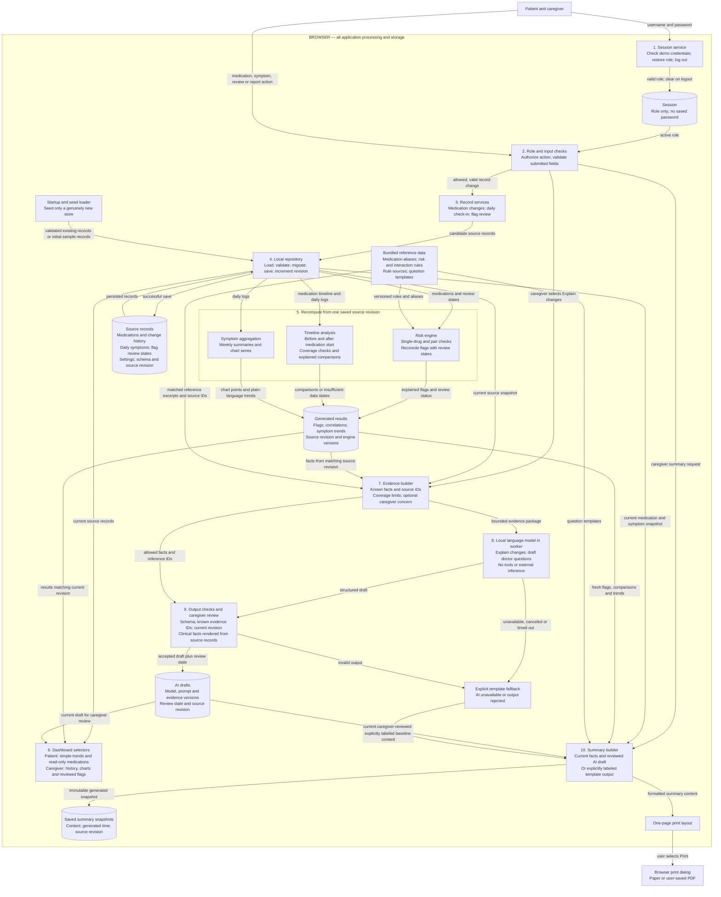
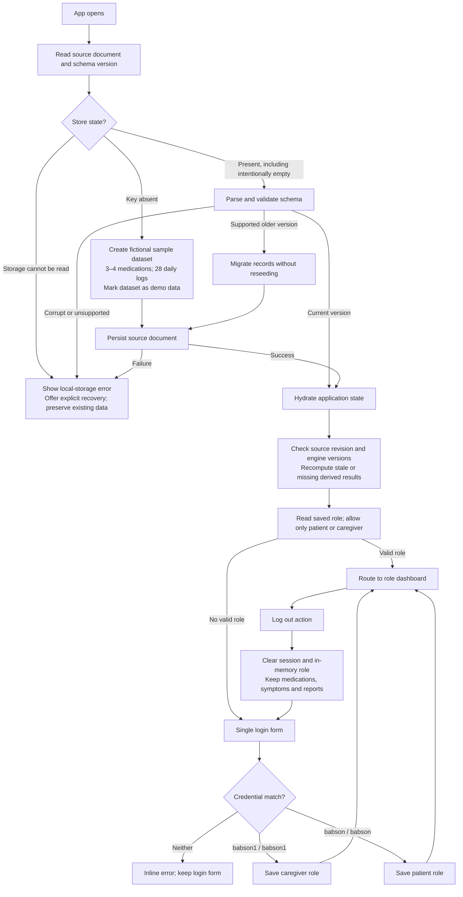
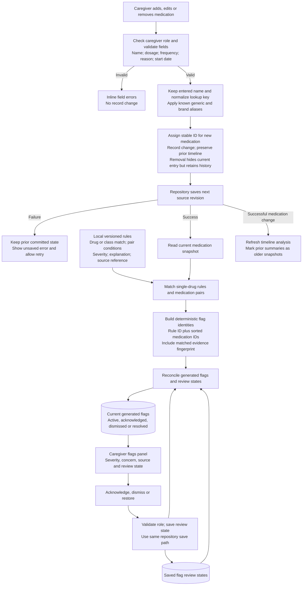
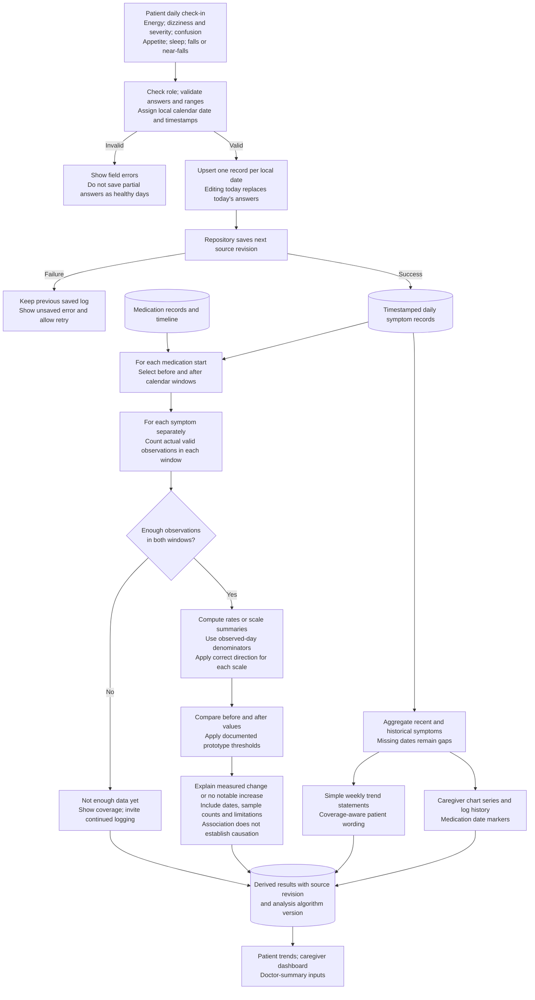
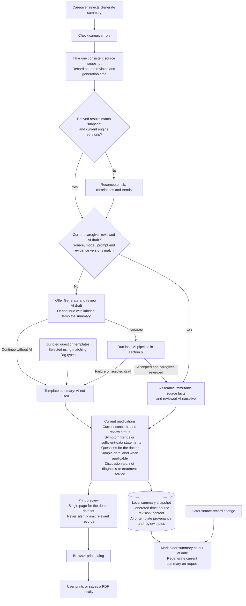
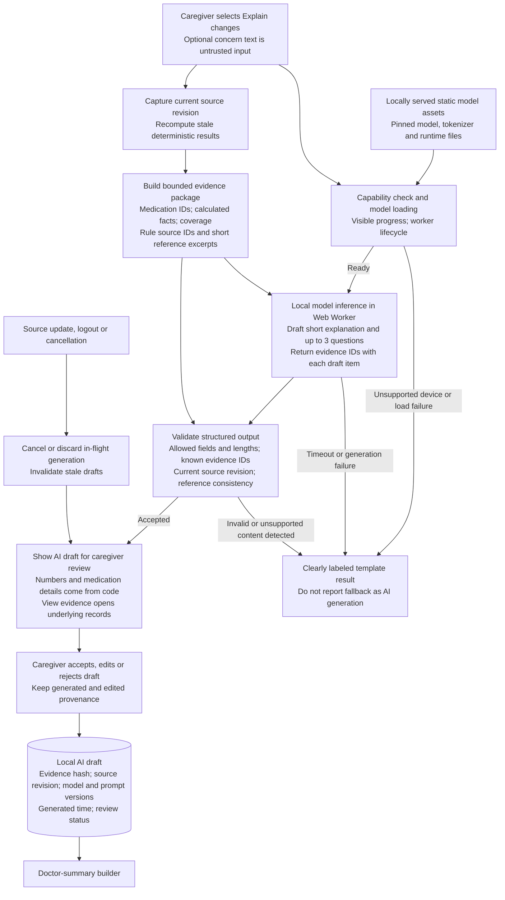
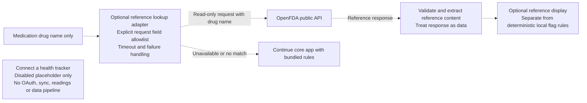

# MedWatch data flow and process architecture

> Archived version 2. Superseded by [the current blueprint](../README.md). Its personalized risk engine and urgency-label paths are not active requirements.

This is the revised proposed architecture for the UnivaBio hackathon prototype. It adds real, local language-model inference to the original rules-based design. All application logic and patient records live in one browser. There is no application server, cloud database, remote authentication service, or remote model API. Patient and caregiver accounts share one fictional patient record in the same browser profile and site origin. This document specifies planned behavior; it does not claim that the app or AI has been implemented or evaluated.

The competition-facing feature is an evidence-linked caregiver brief: deterministic code computes facts and flags, while a local AI model drafts accessible explanations and personalized doctor questions from those facts. See [the archived competition build plan](competition-build-plan-v2.md) for this superseded version's scope, evaluation targets and submission milestones.

Rectangles represent processes, cylinders represent stored data, and labeled arrows identify exchanged data or actions. Dashed arrows identify optional integrations. The numbered diagrams progressively expand the same system.

## 1. Complete system map

The diagram's stores are logical collections. For this prototype, use one versioned localStorage document for source records, a separate session key, and separate derived-result, AI-draft and summary keys. This keeps a source edit together in one storage write. Large model files belong in the model runtime's browser cache, not localStorage. IndexedDB can implement the source repository contract later without changing the services.

## 2. Startup, login and role permissions

| Action | Patient | Caregiver |
|---|---|---|
| Read current medication list | Yes | Yes |
| Add, edit, remove medications | No | Yes |
| Create or edit today's symptom check-in | Yes | Not required by the brief |
| Read simple personal trends | Yes | Yes |
| Read full log history and chart data | Not required by the brief | Yes |
| Acknowledge, dismiss or restore flags | No | Yes |
| Generate or review AI explanations and questions | No in MVP | Yes |
| Generate and print doctor summary | No | Yes |
| Log out | Yes | Yes |

Apply role checks inside the record services as well as navigation. These hardcoded accounts and browser-side checks are demo behavior, not a security boundary or production authentication. Both roles use the same local dataset; logging in on another device does not transfer records.

## 3. Medication management and flag lifecycle

Flag reconciliation rules:

- Keep review state when the same rule matches the same medications with the same relevant evidence.
- A changed dose, drug or other matched condition can create a new evidence fingerprint and require a new review.
- Resolve a generated flag when its condition no longer matches; keep its past review record.
- Acknowledgment records that the concern was seen. Dismissal changes visibility. Neither alters medication records or establishes that a medication is safe.
- An unrecognized medication yields an explicit coverage message, rather than an assertion that there are no risks.
- The dashboard and doctor summary use the same reconciled flag records and documented display policy.

## 4. Symptom logging, trends and timeline comparisons

Proposed implementation defaults, where the brief leaves behavior open:

- Use 14 calendar days before and 14 calendar days after a medication's start date. Exclude the start day because the check-in has no reliable before-dose/after-dose ordering.
- Require at least 7 valid daily observations for the individual symptom in each window. These are prototype coverage settings, not clinically validated cutoffs.
- For yes/no measures, compare symptom-positive days divided by observed days. For ordinal scales, report a clearly defined scale summary; do not imply equal clinical distance between scores.
- Keep dizziness frequency separate from severity on days with dizziness. Report the denominator for each.
- Lower energy or sleep scores and a worse appetite mean a worsening direction; handle each metric explicitly.
- Do not replace missing records with zero. When a baseline is zero, report counts and an absolute change instead of an undefined percentage increase.
- Use a documented, configurable rule for deciding which increases to highlight. Keep it separate from medical risk severity and identify it as illustrative.
- If medication periods overlap or medication details change within a comparison window, include that context. Do not attribute the change exclusively to one medication.
- If a medication is documented as stopped, exclude days after its end date from exposure comparisons. Removing an erroneous list entry does not prove a real-world stop date.
- The seed dataset must satisfy the same coverage checks as real entries; do not hardcode a result for demo mode.

## 5. Doctor summary generation and output

There is no upload or message to a clinician. The output is a locally generated document. Acknowledged unresolved flags remain visible in the report with their status; dismissed unresolved flags are disclosed compactly so they do not disappear from the discussion aid. Resolved historical flags are excluded from the current-concerns section. This is a proposed reporting policy to make review behavior explicit.

One page is the target for the specified small demo dataset. For larger records, permit continuation pages instead of truncating medications or concerns or shrinking text beyond readability.

## 6. Local AI evidence and generation pipeline

The model is responsible for communication: connect relevant observations to the caregiver's stated concern, explain uncertainty in accessible language, and draft personalized questions. Code remains responsible for medication values, dates, counts, risk-rule matches, severity and temporal comparisons. The model must not diagnose a condition, independently add an interaction, claim causation or recommend stopping/changing a medication. No model tools may write records, perform lookups or take clinical actions.

Use a compact response contract such as `explanationItems: [{text, evidenceIds}]` and `questions: [{text, evidenceIds}]`. The UI renders numeric evidence directly from structured facts. A valid schema or valid citation ID does not prove that generated prose is supported; manual factuality review and the evaluation suite are required. Caregiver approval records a review step, not medical validation.

Run inference on demand in the caregiver flow, rather than after every check-in. Until acceptance, label narrative as an AI draft. Keep the patient check-in fast and deterministic. Reject stale responses when the source revision, prompt, model or evidence changes. Keep invalidation and caregiver-review metadata separate from source records so accepting a draft does not invalidate itself.

WebLLM is the initial candidate, subject to a real-device feasibility test. It supports local inference and worker integration; WebGPU support and initial loading must be tested. Serve all runtime/model artifacts from the app's local static asset location, disable default third-party asset downloads, and bundle other dependencies. Cache model artifacts separately from patient data. Downloading dependencies during development is distinct from sending patient data or making runtime third-party calls. [WebLLM setup](https://webllm.mlc.ai/docs/user/get_started.html), [model loading](https://webllm.mlc.ai/docs/user/basic_usage.html), [workers and cache](https://webllm.mlc.ai/docs/user/advanced_usage.html)

Show loading, ready, generating, review-required and fallback states honestly. Record actual generation time and model identity for the technical walkthrough. A cached draft may be displayed with its timestamp; label it as previously generated. A fallback keeps the app usable but does not complete the competition's real-AI demonstration milestone.

## 7. Optional external reference lookup and deferred integration

Keep this optional integration off for the initial demo. If enabled, transmit only the drug-name lookup value: never symptom logs, patient identifiers, dosage, dates, role, summaries or the source document. Confirm the endpoint and returned fields during implementation; API reference text does not automatically become a structured or clinically validated interaction rule. The disabled tracker has no data-flow connections.

## 8. Stored data contract

| Logical collection | Core fields | Writer and readers |
|---|---|---|
| Session | `role`, `signedInAt` | Session service writes; role guard and routing read. Never persist a password. |
| Source document metadata | `schemaVersion`, `sourceRevision`, `updatedAt`, `isDemoData`, `settings` | Repository validates and writes. Every engine reads a consistent revision. |
| Medications | `id`, `name`, `normalizedName`, `dosage`, `frequency`, `reason`, `startDate`, optional `doctor`, optional `endDate`, `removedAt`, timestamps | Caregiver service writes; both roles, risk engine, timeline analysis and report builder read. |
| Medication changes | `eventId`, `medicationId`, `type`, `recordedAt`, optional `effectiveDate`, `before`, `after` | Medication service writes; timeline analysis reads. Record corrections and actual regimen changes must be distinguishable. |
| Daily symptoms | `id`, `dateLocal`, `energy`, `dizziness`, conditional `dizzinessSeverity`, `confusion`, `appetite`, `sleep`, `fallsOrNearFalls`, timestamps | Patient check-in service writes; aggregation, timeline analysis, caregiver history and reports read. Unique key: local date for this single patient. |
| Flag review states | `flagKey`, `evidenceFingerprint`, `status`, `reviewedAt` | Caregiver review service writes; risk reconciliation and report builder read. |
| Generated flags | `flagKey`, `ruleId`, `medicationIds`, `severity`, `explanation`, `sourceReference`, `reviewStatus`, `sourceRevision`, `rulesVersion` | Risk engine writes; dashboard and report builder read. Rebuildable. |
| Generated analytics | `medicationId`, `symptom`, window dates, observation counts, before/after metrics, result state, explanation, trend/chart series, `sourceRevision`, `analysisVersion` | Analysis engines write; dashboards and report builder read. Rebuildable. |
| Evidence package | `sourceRevision`, `evidenceHash`, fact IDs, medication IDs, coverage, source references, optional concern | Evidence builder creates from one snapshot; model and validation read. Rebuildable. |
| AI drafts | `id`, `generatedAt`, `sourceRevision`, `evidenceHash`, `modelId`, `modelVersion`, `promptVersion`, generated narrative, evidence IDs, edited narrative, `reviewStatus`, `mode` | Local AI pipeline and caregiver review write; dashboard and report builder read. `mode` distinguishes AI from templates. |
| Model assets | weights, tokenizer, configuration, compiled runtime, version and license manifest | Local static asset loader populates model runtime cache. Never put model weights in localStorage. |
| Summary snapshots | `id`, `generatedAt`, `sourceRevision`, engine/model/prompt versions, report content, AI/template provenance, `isDemoData` | Summary builder writes; preview/history reads. Preserve as snapshots and label stale results. |
| Bundled reference configuration | aliases, rule IDs and conditions, severity labels, explanations, references, versions, question templates | Shipped as application files; read by matching and reporting. Not patient records. |

Suggested keys: `medwatch.session`, `medwatch.source`, `medwatch.derived`, `medwatch.aiDrafts`, and `medwatch.summaries`. Source records, generated caches, AI drafts/review states and summary snapshots remain separate so regenerating or accepting a draft cannot recursively trigger another source edit.

## 9. Refresh and failure rules

| Trigger | Required downstream behavior |
|---|---|
| First launch with no source key | Seed once, save, then run risk analysis, timeline analysis and symptom aggregation. |
| Medication add, edit or remove | Save source revision; recompute flags and timeline comparisons; update views and mark prior AI drafts and summaries stale. |
| Daily check-in create or edit | Save source revision; recompute trends and timeline comparisons; update views and mark prior AI drafts and summaries stale. |
| Flag acknowledge, dismiss or restore | Save source revision; reconcile flags; update views and mark prior AI drafts and summaries stale. |
| Rule or algorithm version changes | Rebuild affected derived results even if source records are unchanged. |
| Generate AI draft | Build current evidence, run local model, validate output, check revision, then present for caregiver review. |
| Model or prompt changes | Invalidate old drafts for current-report use; keep saved historical provenance. |
| Source changes while AI runs | Cancel or discard the stale result; require a fresh evidence package for the next generation. |
| AI fails or output is rejected | Provide explicit template fallback; retain failure status for evaluation. |
| Caregiver reviews/edits AI draft | Save review and edit provenance outside the source document; do not rerun risk analysis or invalidate the draft solely for this action. |
| Generate summary | Require results matching one consistent current source revision and engine versions. Use a current reviewed AI draft or label the template path. |
| Logout | Cancel generation; clear session and role state; retain patient records and saved reports. |
| Invalid input | Display field errors; do not modify stored records. |
| Failed source write | Keep prior committed state, retain form input for retry, show unsaved status, and do not announce success or run analysis on an uncommitted change. |
| Missing, stale or failed derived cache | Regenerate from source records; show calculating or unavailable state while needed. Never present a stale result as current. |
| Corrupt source document | Preserve the original data; show a recoverable error. Do not silently replace it with seed data. |
| Optional lookup failure | Keep medication management, local risk rules, logging and summaries functional. |

For this dataset size, the simplest implementation is to rerun all three small engines after every successful source change. The trigger table identifies the dependencies and permits selective recomputation later. Commit generated results only when their captured source revision is still current; otherwise discard and rerun.

Local dates and source revisions prevent common demo inconsistencies: duplicate daily entries, timezone-shifted check-ins, flags that lag behind medication edits, and a report containing results from different record versions. Treat multiple simultaneous editing tabs as outside the prototype's single-active-tab assumption unless explicit concurrency handling is added.
