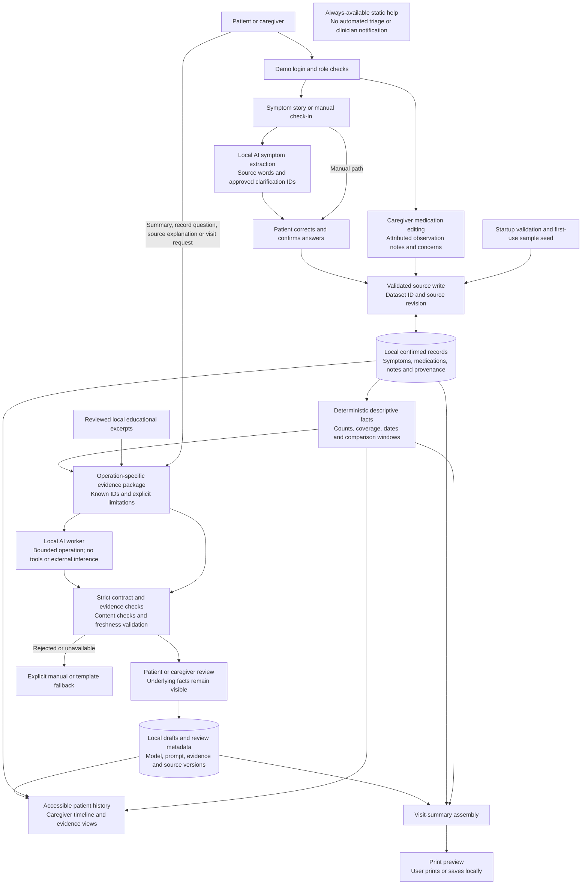

# MedWatch — current data flow

This diagram reflects the version 3 [implementation blueprint](blueprint/README.md). The earlier diagram is preserved in [history](blueprint/history/medwatch-data-flow-v2.md); its personalized risk-engine and urgency-label paths are not active requirements.

## End-to-end application flow

## Data authority and boundaries

- User-confirmed source records are authoritative for the app. AI suggestions and narrative drafts are separate collections.
- Code calculates dates, counts and denominators. The model explains supplied records and selected reference material; it does not establish a clinical interpretation.
- A changed record invalidates dependent drafts. Patient confirmation is required before a proposed symptom field becomes source data. Narrative review is required before AI text enters the visit document.
- The role service, repository, operation policy and request fingerprint are enforced outside the model.
- Static help remains available without AI. There is no inference of whether a user is safe to wait.
- No active clinical risk score, diagnosis, drug-interaction recommendation, medication change, wearable connection, remote model or patient-data server is included.

The [architecture specification](blueprint/02-architecture-and-data.md) includes the module tree, service contracts, records, storage/error handling, lifecycle state diagram, deletion flow and print consistency rules. The [regulatory design brief](blueprint/04-regulatory-and-safety.md) explains why the active scope changed and what remains unassessed.
