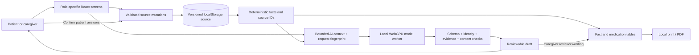

# MedWatch · UnivaBio prototype

A running, fictional-data prototype for recording everyday symptoms, understanding the record, and preparing a caregiver visit brief. The application runs locally; the language model also runs in the browser. No API key is needed.

## Start here

```sh
cd "/Users/mb_pro/Documents/ChatGPT/UnivaBio Hackathon/prototype"
npm install
npm run dev
```

Use Node.js 22.12 or later (tested with Node.js 26.4). You can also launch on this Mac with `Start MedWatch.command`.

Open **http://127.0.0.1:5173/** in current Chrome. The server binds to this Mac only. Keep it running while using the app. The current workspace already has dependencies and model files installed.

| View      | Username  | Password  |
| --------- | --------- | --------- |
| Patient   | `babson`  | `babson`  |
| Caregiver | `babson1` | `babson1` |

These credentials select a demonstration role; they are not secure authentication. Do not enter real health information.

For a fresh checkout, run `npm run model:download` before loading AI. This downloads approximately **845 MiB** of model/runtime artifacts at development time. The application then serves them from local files; runtime prompts and records never go to the download providers. A pinned manifest with file hashes is in `docs/model-manifest.json`. Model weights and `node_modules` are excluded from source control.

## What works

- Patient narrative entry, optional on-device AI extraction, exact supporting quotes, individually selected suggestions, explicit final confirmation, and a complete manual form.
- Seven symptom fields; unanswered values remain null. Up to three AI suggestions are returned per capture to bound latency. The full form remains available for the rest.
- One current daily entry, correction history, and patient-controlled deletion that also clears related drafts.
- Caregiver overview, date filters, gap-preserving energy/sleep charts, calculated counts, and original-record evidence drawers.
- Separate observer notes and patient concerns, with explicit pinning for visit preparation. Observer notes never enter patient denominators.
- Medication-list creation, correction, deletion, recorded start/stop dates, date markers, and conservative before/after counts. These actions document an existing regimen.
- Local AI record summaries, four supported record-question topics, fixed clarification selection, and editable visit-brief wording.
- A template brief that is clearly labeled as not AI generated. Both modes preserve pinned concerns and render medication/fact tables directly from records.
- Review-required PDF printing, including a print guard for unreviewed reports. The sample brief fits one page; longer lists continue on subsequent pages.
- Local JSON export, empty-state persistence, demo reset, corrupt-record recovery, model unloading/cache removal, static emergency help, and a single-writer tab lock.
- Optional read-only WebMCP status tool when a browser exposes `document.modelContext`; no record mutation or raw notes are exposed through it. The health-writing model has no tools.

## AI and its limits

The model is **Qwen2.5-1.5B-Instruct, q4f16**, served with **WebLLM 0.2.85**, running in a dedicated WebGPU worker. Asset revisions and hashes are pinned. Model loading and first generation require some preparation time; all output is buffered until host checks finish. Each generation has a 40-second limit.

Cancelling an active draft terminates its worker and discards the prompt context. Select **Load local AI** again to generate another draft; the downloaded model remains available locally. Leaving a screen or changing records also invalidates pending output.

The host checks response shape, request identity, source revision, exact UTF-16 quote offsets, field-specific support, allowed evidence IDs, repeated numerical values, and detected clinical-advice patterns. It drops unsupported capture proposals. These controls are intentionally conservative and fallible. They do not establish medical safety or regulatory compliance. Natural-language capture can miss details; the patient can always correct or complete the form.

Source text, prompts and output are not sent to a cloud model. Content Security Policy limits background network connections to the local origin. Official reference sites open only when a user selects a fixed link, without record information or a referrer.

**Intentionally unavailable:** source-explanation AI until qualified content review; diagnosis, treatment or dose recommendations; personalized medication-risk scoring; clinical triage; wearable/EHR connections; cloud synchronization; automated clinician notifications; real-patient use. The app is not a clinically validated, FDA-approved or HIPAA-certified product.

## Data and execution

The original backend blueprint is realized as browser modules and a local static server. There is no remote application backend.



`medwatch.demo.source` stores one versioned source document. `medwatch.demo.drafts` holds the current patient form draft. AI narratives and editable report state stay in memory and clear on navigation or record changes. Model assets use a separate browser cache. Logout clears the role session, not the fictional record. Clearing records cannot recall files already exported.

The seed contains 25 entries over the preceding 28 completed days, three intentional gaps, three fictional medication entries, and caregiver notes. Dates move with the local calendar. Today's initial check-in is empty.

## Code tour

| File                                  | Responsibility                                                        |
| ------------------------------------- | --------------------------------------------------------------------- |
| `src/App.tsx`                         | Login, shell, writer lock, navigation, source lifecycle               |
| `src/domain.ts`                       | Dates, seed data, validated source commits, denominators, comparisons |
| `src/Capture.tsx`                     | Patient draft, quote review, manual answers, confirmation             |
| `src/ai.ts`                           | Model adapter, scoped prompts, grammar, validation, evidence checks   |
| `src/ai.worker.ts`                    | Dedicated WebLLM worker                                               |
| `src/Records.tsx`, `src/Evidence.tsx` | History, bounded record QA, notes, provenance                         |
| `src/Medicines.tsx`                   | List CRUD and descriptive date comparisons                            |
| `src/VisitBrief.tsx`                  | AI/template brief, edits, pinned concerns and print review            |
| `src/Settings.tsx`                    | Local data/model controls, source-review gate                         |
| `src/contracts/`                      | Blueprint JSON schemas and generated static validators                |
| `scripts/compile-validators.mjs`      | Generates validators without browser `eval`                           |

## Verification

```sh
npm test                         # Domain, storage and AI-contract checks
npm run build                    # TypeScript and production bundle
npm run test:browser              # Real Chrome, complete manual workflows
node scripts/accessibility.mjs    # Axe WCAG A/AA checks on six screens
node scripts/model-evaluation.mjs # Nine selected real-model synthetic scenarios
node scripts/cancellation-test.mjs # Cancel, preserve source, reload and generate
node scripts/print-test.mjs       # Reviewed print, one-page sample and overflow
```

Run browser checks while the dev server is available on port 5173. Automated tests use isolated browser profiles, not the user's saved demo records. Do not edit application code while model evaluation is running: Vite hot reload interrupts the test page.

The selected model evaluation is **one repeat per scenario**, not the complete 40-case blueprint suite, not an unseen benchmark, and not clinical validation. Actual records are in `docs/model-evaluation.json` and the generated validation notes. Latency targets from the blueprint are goals, not claimed achievements.

## Competition handoff

The project description, code PDF and sample visit brief are under `output/pdf/`. A captioned, working demo is in `output/video/MedWatch-Demo.mp4`; the narration outline is `docs/demo-script.md`. Source is supplied locally and can be uploaded to a GitHub repository after the team reviews it. No repository or site has been published automatically.

Before any real-world release, obtain qualified clinical/content and regulatory/privacy review, define the intended-use classification, replace the demo authentication and storage design, and run the full acceptance suite plus human usability testing. This prototype makes a narrow documentation and communication claim; improved health outcomes have not been measured.

## Preview


